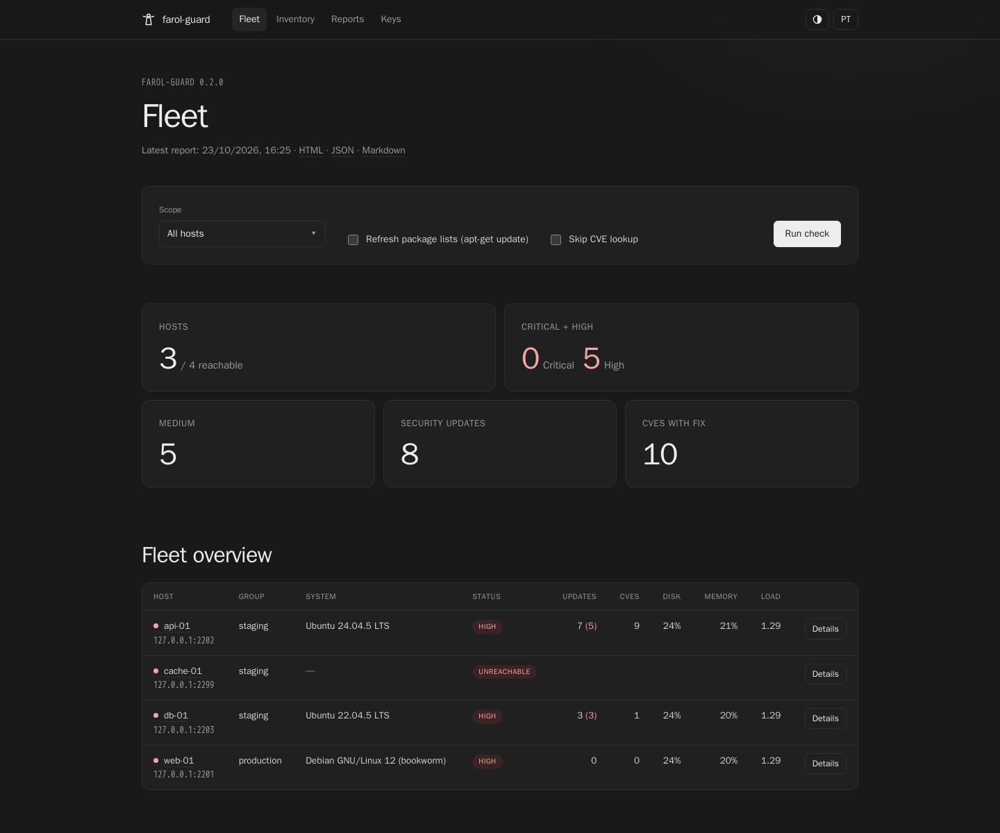

<p align="center">
  
</p>

<h1 align="center">farol-guard</h1>

<p align="center">
  Agentless SSH auditor for Debian and Ubuntu server fleets: users, keys, sshd,
  updates, CVEs and resources, with a local dashboard and safe SSH key rotation.
</p>

<p align="center">
  <a href="https://github.com/dgolveira/farol-guard/actions/workflows/ci.yml"></a>
  <a href="https://github.com/dgolveira/farol-guard/actions/workflows/codeql.yml"></a>
  <a href="https://github.com/dgolveira/farol-guard/releases"></a>
  <a href="https://goreportcard.com/report/github.com/dgolveira/farol-guard"></a>
  <a href="LICENSE"></a>
</p>

<p align="center">
  <b>English</b> | <a href="README.pt-BR.md">Português (Brasil)</a>
</p>

---

<p align="center"></p>

*Farol* is Portuguese for lighthouse. farol-guard watches a fleet of Linux
servers from the outside: it connects over SSH, runs a read-only collector,
and tells you who can log in, with which keys, what is outdated or vulnerable,
and what is about to run out of disk, all without installing anything on the
servers.

## Highlights

- **Agentless and public-key only.** One SSH session per host, a read-only
  collector over `bash -s`, `sudo -n` when you do not log in as root. No
  daemon, no open port, no password logins.
- **Access audit.** Users, UID 0 accounts, sudoers and `NOPASSWD`, every
  `authorized_keys` line with fingerprints, effective `sshd -T` settings, SSH
  logins grouped by source IP and by key.
- **Updates and CVEs.** Pending and security updates (`apt`), end-of-support
  dates, reboot required, and CVEs from [OSV.dev](https://osv.dev) with the
  fixed version and the exact `apt-get install --only-upgrade` command.
- **Health.** Disks and inodes, memory, swap, load, CPU, network interface
  errors, kernel errors, failed systemd units, listening ports, firewall,
  fail2ban, NTP, containers and snaps.
- **Safe key management.** Deploy, rotate and remove keys with dry run,
  backups, login verification and automatic rollback. A dedicated app key
  generated from kernel entropy, encrypted with a passphrase kept in the system
  keyring, installed with `restrict` and optionally `from=`.
- **Dashboard and reports.** Local web UI (English and Brazilian Portuguese,
  light and dark themes), live activity log, inventory editor with groups and
  filters, report history, and self-contained HTML, JSON and Markdown reports.
- **Easy to ship.** A single static Go binary, `.deb` packages for amd64 and
  arm64, a distroless container image, and examples for Docker Compose and
  Kubernetes.

## Screenshots

| Host details | Inventory |
| --- | --- |
|  |  |

| Key management | HTML report |
| --- | --- |
|  |  |

<p align="center"></p>

## How it works

farol-guard never stores SSH passwords and does not support password logins:
**every connection uses an SSH key**. A public key must already be authorized
on each server, for `root` or for a user with passwordless `sudo`, before the
first check. You can reuse the key you already have, or follow
[Getting started](docs/getting-started.md#path-b-prepare-the-access-manually)
to create a dedicated, restricted user and app key by hand.

```text
farol (your workstation) --SSH key--> server: bash -s collector (read-only)
                        <--sections--
       parse, analyze, OSV.dev lookup (package names and versions only)
       -> findings, dashboard, HTML/JSON/Markdown reports
```

## Install

**Debian / Ubuntu package** (from the [releases](https://github.com/dgolveira/farol-guard/releases)):

```bash
sudo apt install ./farol-guard_0.2.1_amd64.deb
farol version
```

The package installs the `farol` binary, a desktop entry that opens the
dashboard, and optional systemd user units for a daily check and for the
dashboard (disabled by default).

**Container image** ([Docker Hub](https://hub.docker.com/r/dgzin01/farol-guard), amd64 and arm64):

```bash
docker run --rm docker.io/dgzin01/farol-guard:0.2.1 version
```

See [deploy/docker](deploy/docker) and [hosting](docs/hosting.md).

**From source** (Go 1.26, or only Docker):

```bash
git clone https://github.com/dgolveira/farol-guard.git
cd farol-guard
make build        # builds inside docker.io/library/golang, output in dist/
make deb          # .deb packages for amd64 and arm64
```

## Quick start

```bash
farol init                                   # sample inventory in ~/.config/farol-guard
$EDITOR ~/.config/farol-guard/inventory.yaml # add your hosts
farol check -o report.html                   # audit and write a report
farol ui                                     # open the dashboard
```

Useful flags for `farol check`: `-g group`, `-H host`, `--refresh` (runs
`apt-get update` first), `--no-cve`, `--fail-on high` (exit code 3 for cron or
CI), `-v` (step by step log), `-f json|md|html`, `--lang en|pt-BR`.

## Security model

The source code is public, so nothing in it can help an attacker. Keys and
secrets are generated at runtime from the kernel CSPRNG on each installation,
there are no default or embedded keys, and the app key is protected by the
system keyring, `restrict` and optionally `from=`. The dashboard listens on
`127.0.0.1` with a session token, a Host header check and CSRF protection.

Details: [SSH keys and security model](docs/keys.md),
[hosting](docs/hosting.md), [security policy](SECURITY.md).

**What leaves your machine:** only package names and versions, sent to
`api.osv.dev` for the CVE lookup. No hostnames, IPs or users. Use `--no-cve`
(or the dashboard option) to skip it.

## Documentation

- [Getting started](docs/getting-started.md): access model, first access, inventory
- [SSH keys and security model](docs/keys.md)
- [Hosting](docs/hosting.md): SSH tunnel, Docker with Caddy, Kubernetes with oauth2-proxy
- [Development](docs/development.md): build, test lab, layout

## FAQ

**Do I need to install anything on the servers?**
No. farol-guard only needs SSH access with a key, and `sudo -n` (or root) for a
complete audit.

**Does it change anything on the servers?**
Checks are read-only. The only optional write during a check is
`apt-get update` when you enable "Refresh package lists". Key operations change
`authorized_keys`, always with dry run, backup and verification.

**Which distributions are supported?**
Debian 10 to 13 and Ubuntu 18.04 to 26.04 as targets. Other distributions are
collected partially, without update and CVE evaluation.

**Why are kernel CVEs only counted?**
OSV lists thousands of advisories for kernel packages. farol-guard counts them
and relies on `apt` security updates and the reboot-required flag for the
kernel instead of downloading hundreds of megabytes.

**My server blocked me after a few checks.**
Tools like sshguard and fail2ban count aborted handshakes. farol-guard opens at
most one aborted connection per new host (to capture its host key) and skips
hosts whose key is still pending review.

**Is there a login screen for hosting?**
Not built in. Put it behind an authenticating proxy, see [hosting](docs/hosting.md).
Contributions are welcome.

## Contributing

Issues and pull requests are welcome. Read [CONTRIBUTING.md](CONTRIBUTING.md)
and the [Code of Conduct](CODE_OF_CONDUCT.md). Report vulnerabilities privately
as described in [SECURITY.md](SECURITY.md).

## License

[MIT](LICENSE). Third-party components are listed in
[THIRD_PARTY_NOTICES.md](THIRD_PARTY_NOTICES.md). CVE data comes from
[OSV.dev](https://osv.dev) and its upstream sources (Debian Security Tracker,
Ubuntu Security Notices).
