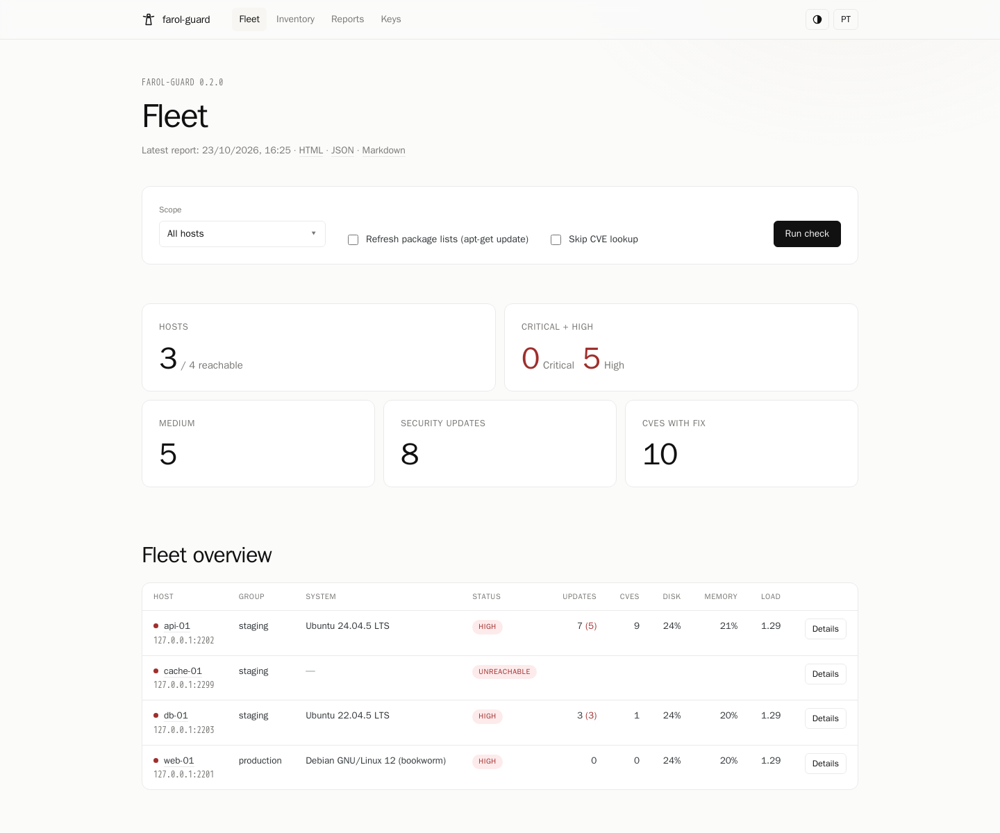
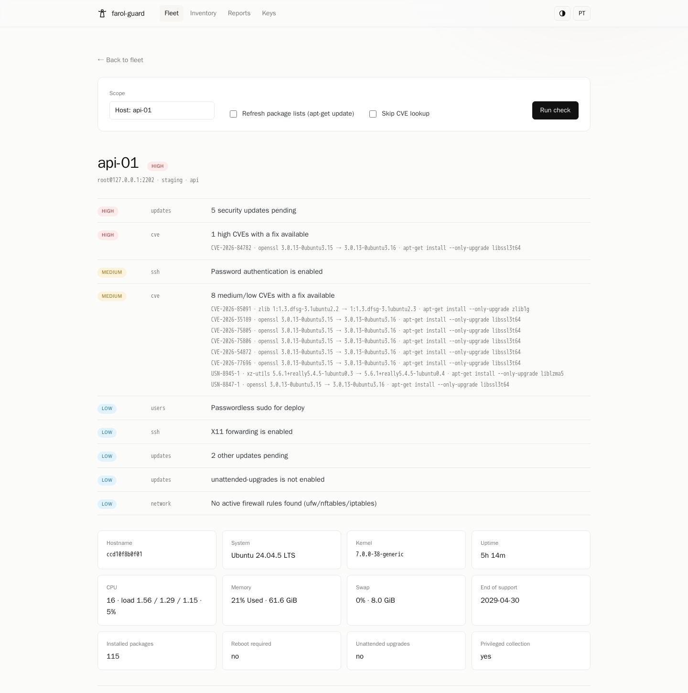
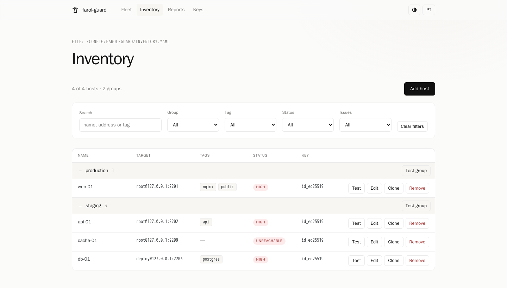
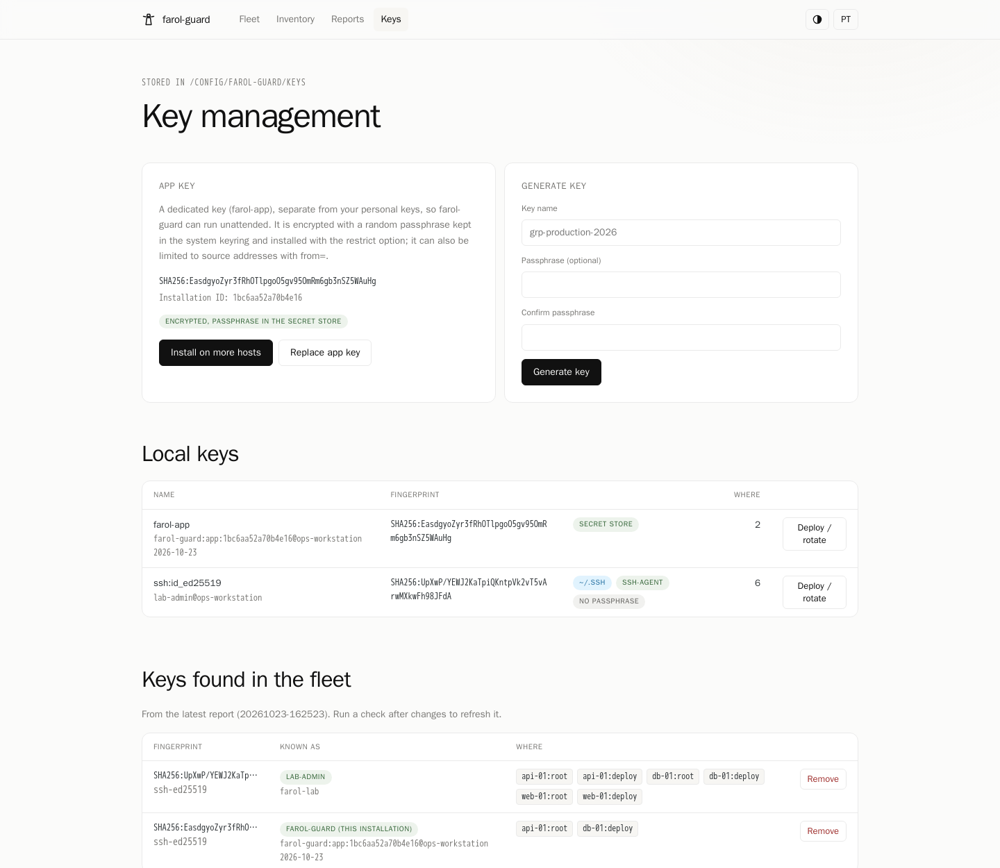
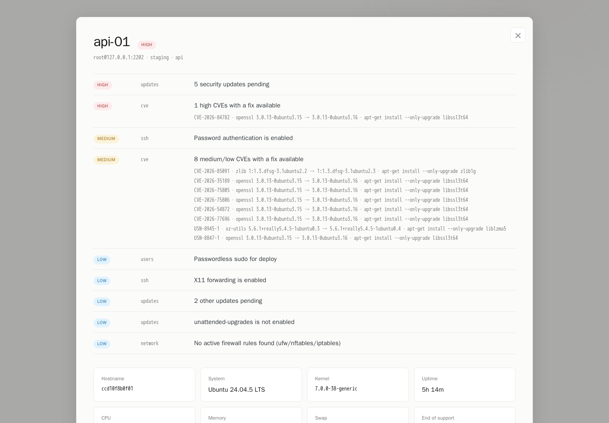

<p align="center">
  
</p>

<h1 align="center">farol-guard</h1>

<p align="center">
  Auditor de servidores Debian e Ubuntu via SSH, sem agente: usuários, chaves,
  sshd, atualizações, CVEs e recursos, com dashboard local e rotação segura de
  chaves SSH.
</p>

<p align="center">
  <a href="https://github.com/dgolveira/farol-guard/actions/workflows/ci.yml"></a>
  <a href="https://github.com/dgolveira/farol-guard/actions/workflows/codeql.yml"></a>
  <a href="https://github.com/dgolveira/farol-guard/releases"></a>
  <a href="https://goreportcard.com/report/github.com/dgolveira/farol-guard"></a>
  <a href="LICENSE"></a>
</p>

<p align="center">
  <a href="README.md">English</a> | <b>Português (Brasil)</b>
</p>

---

<p align="center"></p>

O farol-guard vigia uma frota de servidores Linux por fora: conecta por SSH,
roda um coletor somente leitura e mostra quem pode entrar, com quais chaves, o
que está desatualizado ou vulnerável e o que está perto de ficar sem disco, sem
instalar nada nos servidores.

## Destaques

- **Sem agente e só com chave pública.** Uma sessão SSH por host, coletor
  somente leitura via `bash -s` e `sudo -n` quando você não entra como root.
  Nenhum daemon, nenhuma porta aberta, nenhum login por senha.
- **Auditoria de acesso.** Usuários, contas com UID 0, sudoers e `NOPASSWD`,
  cada linha do `authorized_keys` com fingerprint, configuração efetiva do
  `sshd -T`, logins SSH agrupados por IP de origem e por chave.
- **Atualizações e CVEs.** Atualizações pendentes e de segurança (`apt`), fim
  do suporte da versão, reboot pendente e CVEs da [OSV.dev](https://osv.dev)
  com a versão corrigida e o comando `apt-get install --only-upgrade` exato.
- **Saúde.** Discos e inodes, memória, swap, load, CPU, erros de interface de
  rede e de kernel, units do systemd com falha, portas abertas, firewall,
  fail2ban, NTP, containers e snaps.
- **Gestão segura de chaves.** Instalar, rotacionar e remover chaves com
  simulação, backup, verificação de login e rollback automático. Uma chave
  dedicada do app gerada com entropia do kernel, criptografada com senha
  guardada no chaveiro do sistema, instalada com `restrict` e opcionalmente
  `from=`.
- **Dashboard e relatórios.** Interface web local (inglês e português, temas
  claro e escuro), log de atividade ao vivo, editor de inventário com grupos e
  filtros, histórico e relatórios HTML, JSON e Markdown.
- **Fácil de distribuir.** Um binário Go estático, pacotes `.deb` para amd64 e
  arm64, imagem de container distroless e exemplos para Docker Compose e
  Kubernetes.

## Telas

| Detalhes do host | Inventário |
| --- | --- |
|  |  |

| Gestão de chaves | Relatório HTML |
| --- | --- |
|  |  |

## Como funciona

O farol-guard nunca guarda senhas de SSH e não aceita login por senha: **toda
conexão usa chave SSH**. Antes da primeira verificação, uma chave pública já
precisa estar autorizada em cada servidor, para o `root` ou para um usuário com
`sudo` sem senha. Você pode usar a chave que já tem, ou seguir os
[primeiros passos](docs/getting-started.md#path-b-prepare-the-access-manually)
para criar manualmente um usuário dedicado e restrito e a chave do app.

## Instalação

**Pacote Debian / Ubuntu** (nas [releases](https://github.com/dgolveira/farol-guard/releases)):

```bash
sudo apt install ./farol-guard_1.0.1_amd64.deb
farol version
```

O pacote instala o binário `farol`, o ícone **farol-guard** no menu de
aplicativos (inicia o dashboard em segundo plano e abre o navegador; com o
botão direito há "Parar o dashboard") e units de usuário do systemd para a
verificação diária e para o dashboard (desabilitadas por padrão).

**Imagem de container** ([GitHub Container Registry](https://github.com/dgolveira/farol-guard/pkgs/container/farol-guard), amd64 e arm64):

```bash
docker run --rm ghcr.io/dgolveira/farol-guard:1.0.1 version
```

**A partir do código** (Go 1.26, ou apenas Docker):

```bash
git clone https://github.com/dgolveira/farol-guard.git
cd farol-guard
make build
make deb
```

## Uso rápido

```bash
farol init                                   # inventário de exemplo em ~/.config/farol-guard
$EDITOR ~/.config/farol-guard/inventory.yaml # cadastre seus hosts
farol check -o relatorio.html                # audita e gera o relatório
farol open                                   # inicia o dashboard e abre o navegador
```

Flags úteis do `farol check`: `-g grupo`, `-H host`, `--refresh` (roda
`apt-get update` antes), `--no-cve`, `--fail-on high` (código de saída 3 para
cron ou CI), `-v` (log passo a passo), `-f json|md|html`, `--lang en|pt-BR`.

## Modelo de segurança

O código é público, então nada nele ajuda um atacante. Chaves e segredos são
gerados na hora, com o gerador criptográfico do kernel, em cada instalação; não
existem chaves padrão ou embutidas; e a chave do app é protegida pelo chaveiro
do sistema, por `restrict` e opcionalmente por `from=`. O dashboard escuta em
`127.0.0.1` com token de sessão, checagem do cabeçalho Host e proteção contra
CSRF.

**O que sai da sua máquina:** apenas nomes e versões de pacotes, enviados para
`api.osv.dev` na consulta de CVEs. Nenhum hostname, IP ou usuário. Use
`--no-cve` (ou a opção no dashboard) para pular.

## Documentação

A documentação detalhada está em inglês:

- [Primeiros passos](docs/getting-started.md): modelo de acesso, primeiro acesso, inventário
- [Chaves SSH e modelo de segurança](docs/keys.md)
- [Hospedagem](docs/hosting.md): túnel SSH, Docker com Caddy, Kubernetes com oauth2-proxy
- [Desenvolvimento](docs/development.md): build, laboratório de testes, estrutura

## Perguntas frequentes

**Preciso instalar algo nos servidores?**
Não. Basta acesso SSH com chave e `sudo -n` (ou root) para a auditoria completa.

**Ele altera algo nos servidores?**
As verificações são somente leitura. A única escrita opcional é o
`apt-get update` quando você marca "Atualizar listas de pacotes". As operações
de chave alteram o `authorized_keys`, sempre com simulação, backup e
verificação.

**Quais distribuições são suportadas?**
Debian 10 a 13 e Ubuntu 18.04 a 26.04. Outras distribuições são coletadas
parcialmente, sem avaliação de atualizações e CVEs.

**Meu servidor me bloqueou depois de algumas verificações.**
Ferramentas como sshguard e fail2ban contam handshakes interrompidos. O
farol-guard abre no máximo uma conexão interrompida por host novo (para
capturar a chave do host) e pula hosts cuja chave ainda aguarda revisão.

**Existe tela de login para hospedar?**
Não embutida. Coloque um proxy com autenticação na frente, veja
[hospedagem](docs/hosting.md). Contribuições são bem-vindas.

## Contribuindo

Issues e pull requests são bem-vindos. Leia o [CONTRIBUTING.md](CONTRIBUTING.md)
e o [Código de Conduta](CODE_OF_CONDUCT.md). Vulnerabilidades devem ser
reportadas de forma privada, como descrito no [SECURITY.md](SECURITY.md).

## Licença

[MIT](LICENSE). Componentes de terceiros estão em
[THIRD_PARTY_NOTICES.md](THIRD_PARTY_NOTICES.md).
